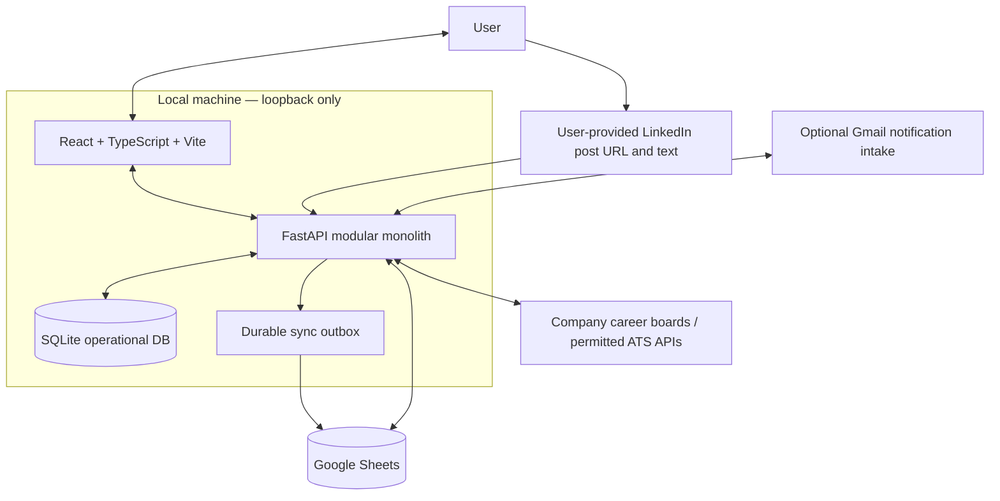
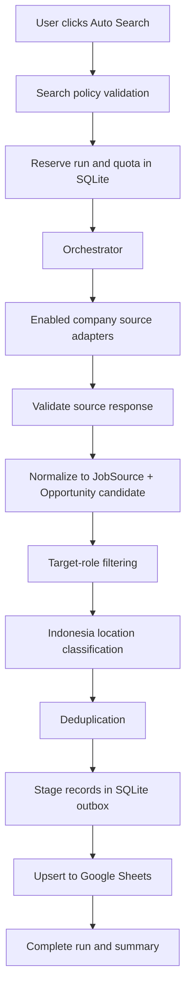
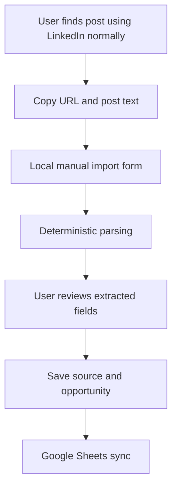

# 02 — System Architecture

**Version:** 0.1.0  
**Architecture style:** Local-first modular monolith

## 1. Architecture overview

The application consists of:
- React + TypeScript + Vite frontend.
- Python + FastAPI backend.
- SQLite operational database.
- Google Sheets as the user-visible opportunity store.
- Source adapters for permitted ATS/career sources.
- Optional Gmail notification ingestion.
- Manual LinkedIn post intake.

No cloud service, public backend, task queue, or background scheduler is required for MVP.

## 2. System context



## 3. Architecture decisions

### 3.1 Modular monolith

One FastAPI application contains clearly separated modules. This is appropriate for a single-user local application and avoids distributed-system complexity.

### 3.2 Frontend/backend separation

React handles presentation and user interaction. FastAPI owns business rules, source access, search execution, normalization, and storage integrations.

Development:
- Vite dev server: `127.0.0.1:5173`.
- FastAPI: `127.0.0.1:8000`.
- Vite proxies `/api` to FastAPI.

Normal local use:
- Build React static assets.
- FastAPI serves the built frontend and `/api/v1/*` from one local origin.
- Bind only to `127.0.0.1` by default.

### 3.3 Backend modules

| Module | Responsibility |
|---|---|
| `api` | REST routes, request/response schemas |
| `core` | Settings, logging, timezone helpers, security |
| `domain` | Opportunity, source, contact, company, run models |
| `search` | Search policy, quota reservation, orchestration, lifecycle |
| `connectors` | ATS/career source adapters and optional email intake |
| `ingestion` | Parsing, validation, normalization |
| `intelligence` | Role relevance, location classification, duplicate candidates |
| `repositories` | Google Sheets and SQLite access |
| `integrations` | OAuth, Sheets API, optional Gmail API |

### 3.4 Frontend feature modules

```text
frontend/src/
├── app/
├── components/
├── features/
│   ├── dashboard/
│   ├── search-control/
│   ├── job-feed/
│   ├── job-detail/
│   ├── hiring-posts/
│   ├── contacts/
│   ├── companies/
│   ├── search-settings/
│   ├── search-history/
│   └── integrations/
├── lib/
└── types/
```

Use feature-based organization. Avoid a large generic `components` folder containing all business logic.

## 4. Data flow

### 4.1 Company career source flow



### 4.2 LinkedIn post flow



No automated browser access to LinkedIn is part of this flow.

### 4.3 Optional Gmail alert flow

When explicitly enabled, Gmail notification messages are read only when the user triggers a search run or an explicit import action. The integration must use the narrowest feasible Gmail access and must be evaluated against Google's OAuth scope and verification requirements before implementation. `gmail.readonly` is a restricted scope; it must not be treated as a trivial permission.

## 5. Search execution lifecycle

States:
- `accepted`
- `running`
- `completed`
- `completed_with_warnings`
- `completed_pending_sync`
- `failed`
- `interrupted`

A `POST /api/v1/search-runs` request returns HTTP 202 after the backend has atomically reserved quota and persisted the run.

The orchestrator runs in-process. It may use asyncio tasks for concurrency within the single backend process. This is not a durable external queue.

On backend startup:
- Find previous runs still marked `accepted` or `running`.
- Mark them `interrupted`.
- Do not resume them automatically.
- Preserve their consumed quota and cooldown timestamp.

On graceful shutdown:
- Mark the active run `interrupted` or use a recoverable shutdown marker.
- Do not auto-resume after next startup.

If the browser tab closes while the backend process remains alive, the backend search may continue. If the backend/laptop stops, the run is interrupted.

## 6. Background execution choice

MVP does not use Celery, Redis, APScheduler, or a separate worker service.

Use a controlled in-process orchestrator:
- API endpoint validates and persists run.
- API returns 202.
- Backend starts one managed task.
- Run progress is persisted to SQLite.
- Frontend polls run status.
- Shutdown/startup hooks reconcile unfinished runs.

Keep the orchestration interface independent so a durable worker can be introduced later if requirements change.

## 7. API and local network security

- Bind backend to `127.0.0.1`, not `0.0.0.0`.
- Allow only expected local frontend origin during development.
- Validate Host/Origin on state-changing requests.
- Do not expose OAuth tokens in API responses or logs.
- Do not place Google credentials in frontend source or Vite `VITE_*` variables.
- Keep secrets and tokens outside Git.
- Use OS credential storage where practical; otherwise protect local token files with restrictive permissions.
- Use a local data directory excluded from version control.

## 8. Google Sheets and SQLite responsibilities

Google Sheets:
- User-visible opportunities.
- Job source provenance.
- Recruiter contacts explicitly provided in source text.
- Companies/board registry if managed as sheet data.
- Search run summaries.
- Formula/chart-driven dashboard.

SQLite:
- Search run lifecycle and quota enforcement.
- Operational-day state.
- Cooldown timestamps.
- Active run lock.
- Sync outbox with staged payloads.
- Cache/checkpoints and optional connector cursors.

Google Sheets is the primary user-facing record store. SQLite is authoritative for operational control and temporarily retains data awaiting synchronization.

## 9. Sync reliability

- Every entity has a stable application ID.
- Writes must be idempotent.
- Use batch reads/writes where possible.
- Stage normalized records in SQLite before attempting Sheets write.
- If Sheets write fails, mark `completed_pending_sync` and preserve the payload in an outbox.
- Provide `Retry Sync` as a separate action. It retries persistence only; it does not call job-source connectors or consume Auto Search quota.
- Never silently discard a pending outbox item.

## 10. Concurrency and request limits

- One search run at a time.
- Max two concurrent requests by default across source connectors; source-specific limits may be lower.
- Each connector defines pagination and request budgets based on its source documentation.
- Use timeouts, bounded retries, cache/conditional requests when supported.
- Stop on HTTP 403; do not circumvent.
- On HTTP 429, honor provider guidance and bounded exponential backoff.
- Do not use proxy rotation, account rotation, stealth fingerprints, or rate-limit evasion.

## 11. Frontend/backend communication

- REST API under `/api/v1`.
- `POST /search-runs` returns 202 and a `run_id`.
- Frontend polls `GET /search-runs/{run_id}` while active.
- Polling stops after terminal status.
- No WebSocket required for MVP.
- TanStack Query manages server state and caching.
